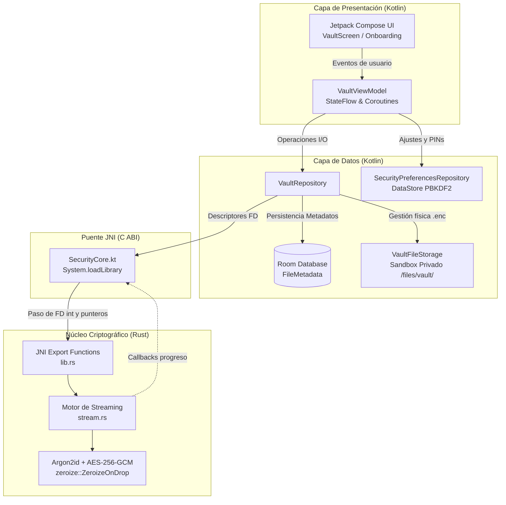

# 🔒 Documentación Técnica y Arquitectura de RamLock

> **Guía exhaustiva sobre el funcionamiento interno de RamLock:** Arquitectura Clean, Criptografía nativa en Rust, Puente JNI (Java Native Interface), Zero-Allocation Streaming y Seguridad en Android.

---

## 📑 Tabla de Contenidos

1. [Filosofía y Arquitectura General](#1-filosofía-y-arquitectura-general)
2. [El Núcleo Criptográfico en Rust (`rust_core`)](#2-el-núcleo-criptográfico-en-rust-rust_core)
   * 2.1. Derivación de Claves: Argon2id
   * 2.2. Cifrado Autenticado: AES-256-GCM
   * 2.3. Higiene de Memoria con `zeroize`
   * 2.4. Protocolo de Streaming (STREAM Construction)
3. [El Puente JNI: Comunicación Kotlin ↔ Rust](#3-el-puente-jni-comunicación-kotlin--rust)
   * 3.1. ¿Qué es JNI y cómo enlaza con Rust?
   * 3.2. Cero Reservas en Heap: La Magia de los File Descriptors
   * 3.3. Callbacks en Tiempo Real (Rust → JVM)
4. [Capa de Android (Kotlin & Jetpack Compose)](#4-capa-de-android-kotlin--jetpack-compose)
   * 4.1. Hashing Salteado de PINs con PBKDF2
   * 4.2. Mecanismo de Pánico (*Emergency Wipe*)
   * 4.3. Anti-Capturas y Protección en RAM
   * 4.4. Aislamiento de Backups (Zero-Knowledge)
   * 4.5. Triturado Seguro de Archivos Temporales (*Shredding*)
5. [Compilación Cruzada (Cross-Compilation NDK)](#5-compilación-cruzada-cross-compilation-ndk)
6. [Resumen del Flujo de un Archivo de Extremo a Extremo](#6-resumen-del-flujo-de-un-archivo-de-extremo-a-extremo)

---

## 1. Filosofía y Arquitectura General

RamLock nació con un propósito claro: **demostrar cómo construir una aplicación de privacidad sin concesiones en Android**, combinando la expresividad y modernidad de **Kotlin + Jetpack Compose** con la velocidad, robustez y control de memoria de bajo nivel que ofrece **Rust**.

### ¿Por qué una arquitectura híbrida?
* **El problema de Java/Kotlin para criptografía:** En la Máquina Virtual de Java (JVM/ART), los objetos como `String` o `byte[]` son inmutables o quedan a merced del recolector de basura (*Garbage Collector*). Un atacante con acceso a la memoria del proceso podría leer fragmentos de contraseñas o claves maestras minutos u horas después de haber sido usadas.
* **La solución en Rust:** Rust no tiene recolector de basura. Los buffers de memoria se destruyen en el milisegundo exacto en que salen de su ámbito (*scope*), permitiendo sobrescribir físicamente con ceros binarios cualquier secreto antes de liberarlo.



---

## 2. El Núcleo Criptográfico en Rust (`rust_core`)

El directorio `rust_core/` es una librería dinámica compilada como `cdylib` (`librust_core.so`).

### 2.1. Derivación de Claves: Argon2id
No se puede usar una contraseña escrita por el usuario directamente como clave AES, ya que una contraseña típica tiene baja entropía.

Para transformar la contraseña en una clave criptográfica de **32 bytes (256 bits)** usamos **Argon2id** (ganador de la *Password Hashing Competition*):
* **Resistencia a ataques por GPU/ASIC:** A diferencia de SHA-256 o MD5, Argon2id requiere tanto memoria RAM como tiempo de CPU, impidiendo que tarjetas gráficas ejecuten miles de millones de intentos por segundo.
* **Salt criptográfico:** Por cada archivo o sesión, generamos **16 bytes aleatorios** usando `rand_core::OsRng` (generador seguro del kernel de Linux). Dos archivos con la misma contraseña tendrán claves AES completamente distintas.

```rust
pub fn derive_from_password(password: &mut String, salt: &[u8]) -> Result<Self, String> {
    let mut key = SecureKey { bytes: [0; 32] };
    let argon2 = Argon2::default();
    if let Err(e) = argon2.hash_password_into(password.as_bytes(), salt, &mut key.bytes) {
        password.zeroize();
        return Err(format!("Argon2 error: {}", e));
    }
    // Sobrescribir inmediatamente la contraseña original en RAM
    password.zeroize();
    Ok(key)
}
```

### 2.2. Cifrado Autenticado: AES-256-GCM
AES-256 en modo **GCM (Galois/Counter Mode)** es un algoritmo de tipo **AEAD** (*Authenticated Encryption with Associated Data*):
1. **Confidencialidad:** Cifra los datos para que nadie pueda leerlos.
2. **Integridad y Autenticidad:** Genera una etiqueta (*Authentication Tag*) de **16 bytes**. Si un atacante modifica un solo bit del archivo cifrado, el descifrado fallará de inmediato sin procesar datos corruptos.

### 2.3. Higiene de Memoria con `zeroize`
En Rust, la clave derivada se envuelve en la estructura:

```rust
#[derive(Zeroize, ZeroizeOnDrop)]
pub struct SecureKey {
    pub bytes: [u8; 32],
}
```

Gracias al macro `#[derive(ZeroizeOnDrop)]`, en el momento exacto en que la variable `key` sale del bloque donde fue creada, Rust ejecuta el destructor (*Drop trait*), llenando sus 32 bytes con `0x00`. Esto mitiga ataques de tipo *cold-boot* o volcados de memoria `/proc/$PID/mem`.

### 2.4. Protocolo de Streaming (STREAM Construction)

Para evitar cargar archivos pesados en memoria (lo que en Android provocaría un cierre forzoso por `OutOfMemoryError`), diseñamos un motor de streaming en [`rust_core/src/stream.rs`](file:///C:/Users/migue/AndroidStudioProjects/RamLock/rust_core/src/stream.rs):

#### Estructura binaria de un archivo `.enc`:

```text
┌────────────────────────────────────────────────────────────────────────┐
│                        CABECERA INICIAL (28 bytes)                     │
├──────────────┬──────────────┬──────────────┬───────────────────────────┤
│ Magic (4B)   │ Versión (1B) │ Salt (16B)   │ Nonce Prefix (7B)         │
│ b"RMLK"      │ 0x01         │ (Argon2id)   │ (Prefijo aleatorio base)  │
└──────────────┴──────────────┴──────────────┴───────────────────────────┘
                                   ▼
┌────────────────────────────────────────────────────────────────────────┐
│                          CHUNKS DE 256 KB                              │
├────────────────────────────────────────────────────────────────────────┤
│ Cada chunk se compone de:                                              │
│ 1. chunk_len (4 bytes, Big-Endian): tamaño del payload cifrado         │
│ 2. Datos cifrados con AES-256-GCM (hasta 256 KB + 16B Tag)             │
│                                                                        │
│ * Construcción del Nonce de 12 bytes por bloque:                       │
│   [7B Nonce Prefix] + [4B Contador: 0, 1, 2...] + [1B is_last flag]    │
└────────────────────────────────────────────────────────────────────────┘
```

#### ¿Por qué esta estructura es inviolable?
1. **Contra reordenación de bloques:** Como cada bloque incluye su número de contador (`0, 1, 2...`) dentro del Nonce de autenticación, un atacante no puede cambiar el orden de las partes del archivo.
2. **Contra truncamiento:** El último bloque se marca con `is_last = 1` y todos los anteriores con `is_last = 0`. Si alguien corta el archivo por la mitad, el descifrado detecta que faltan datos y rechaza el archivo.
3. **Zero-Allocation en bucle (`std::mem::swap`):** En lugar de crear un vector en cada iteración, reservamos únicamente dos buffers de 256 KB antes de entrar al bucle (`buf_current` y `buf_next`) e intercambiamos sus punteros en 2 ciclos de reloj.

---

## 3. El Puente JNI: Comunicación Kotlin ↔ Rust

El **Java Native Interface (JNI)** es el mecanismo estándar mediante el cual la Máquina Virtual de Android (ART) interactúa con código nativo en C/C++ o Rust.

### 3.1. ¿Cómo se comunican?
Cuando en Kotlin escribes:
```kotlin
package com.tuidev.ramlock.security

object SecurityCore {
    init {
        System.loadLibrary("rust_core") // Carga librust_core.so
    }

    external fun encryptStream(
        password: String,
        inFd: Int,
        outFd: Int,
        totalBytes: Long,
        listener: StreamProgressListener?
    ): Boolean
}
```

La JVM busca en la librería nativa un símbolo público exportado con la convención de nombres C:
`Java_<paquete_con_guiones_bajos>_<Clase>_<nombreMetodo>`:

```rust
#[unsafe(no_mangle)]
pub extern "system" fn Java_com_tuidev_ramlock_security_SecurityCore_encryptStream<'local>(
    mut env: JNIEnv<'local>,
    _class: JClass<'local>,
    password: JString<'local>,
    fd_in: jint,
    fd_out: jint,
    total_bytes: jlong,
    progress_listener: JObject<'local>,
) -> jboolean
```

### 3.2. Cero Reservas en Heap: La Magia de los File Descriptors

Si pasáramos los datos como `ByteArray` (`jbyteArray`), un vídeo de 1 GB ocuparía:
* 1 GB en el buffer de Kotlin.
* 1 GB duplicado al cruzar la frontera JNI.
* 1 GB en Rust.
* **Total:** 3 GB de RAM ➔ `OutOfMemoryError` garantizado.

#### La solución implementada en RamLock:
Tanto Linux como Android gestionan cualquier archivo abierto mediante un **Descriptor de Archivo (`fd`)**, que no es más que un simple número entero (`Int` / `jint`).

1. Kotlin obtiene el `ParcelFileDescriptor` del archivo de origen (vía SAF) y del archivo `.enc` de destino.
2. Kotlin envía **solamente los dos números enteros** a Rust: `inStream.fd` y `outStream.fd`.
3. En Rust, convertimos esos números en streams nativos usando `std::os::fd::FromRawFd`:

```rust
use std::os::fd::{FromRawFd, IntoRawFd};

let mut file_in = unsafe { std::fs::File::from_raw_fd(fd_in) };
let mut file_out = unsafe { std::fs::File::from_raw_fd(fd_out) };

let mut reader = std::io::BufReader::with_capacity(256 * 1024, &mut file_in);
let mut writer = std::io::BufWriter::with_capacity(256 * 1024, &mut file_out);

// Cifrado directo a nivel de kernel
let result = stream::encrypt_stream_with_progress(&mut password_rust, &mut reader, &mut writer, cb);

// Evitar que Rust cierre el descriptor al salir:
let _ = file_in.into_raw_fd();
let _ = file_out.into_raw_fd();
```

> [!IMPORTANT]
> **El truco de `into_raw_fd()`:** En Rust, cuando un `File` se destruye, invoca automáticamente `close(fd)`. Al llamar a `into_raw_fd()`, Rust cede la propiedad de vuelta sin invocar `close()`. Así, el bloque `use { ... }` de Kotlin en Android puede cerrar el descriptor ordenadamente sin producir errores `EBADF` ni advertencias en el sistema operativo.

### 3.3. Callbacks en Tiempo Real (Rust → JVM)

Para mostrar la barra de progreso en vivo, Rust llama a la JVM periódicamente:

```rust
let has_listener = !progress_listener.as_raw().is_null();
let cb = if has_listener {
    Some(|bytes: u64| {
        let _ = env.call_method(
            &progress_listener,
            "onProgress",
            "(JJ)V", // Firma JNI: dos parámetros Long (J), retorno Void (V)
            &[
                jni::objects::JValue::Long(bytes as i64),
                jni::objects::JValue::Long(total_bytes),
            ],
        );
    })
} else {
    None
};
```

---

## 4. Capa de Android (Kotlin & Jetpack Compose)

### 4.1. Hashing Salteado de PINs con PBKDF2
En [`SecurityPreferencesRepository.kt`](file:///C:/Users/migue/AndroidStudioProjects/RamLock/app/src/main/java/com/tuidev/ramlock/data/SecurityPreferencesRepository.kt), los PINs nunca se almacenan en texto plano en el disco:
* **Algoritmo:** `PBKDF2WithHmacSHA256` con **10.000 iteraciones** y clave de 256 bits.
* **Salt:** 16 bytes generados con `SecureRandom()`.
* **Comparación en tiempo constante:** Se utiliza `MessageDigest.isEqual(hash1, hash2)` para impedir ataques de temporización (*timing attacks*) donde un espía mide microsegundos de CPU para adivinar caracteres.

### 4.2. Mecanismo de Pánico (*Emergency Wipe*)
Si el usuario se encuentra bajo coacción y se le obliga a abrir la bóveda:
* Al introducir el **PIN de Pánico**:
  1. El sistema borra físicamente todos los archivos del directorio `/files/vault/`.
  2. Borra todos los registros indexados en la base de datos Room (`deleteAllFiles()`).
  3. Desbloquea la interfaz mostrando una bóveda completamente vacía, simulando que no había nada guardado.

### 4.3. Anti-Capturas y Protección en RAM
En [`MainActivity.kt`](file:///C:/Users/migue/AndroidStudioProjects/RamLock/app/src/main/java/com/tuidev/ramlock/MainActivity.kt#L73):
```kotlin
window.setFlags(
    WindowManager.LayoutParams.FLAG_SECURE,
    WindowManager.LayoutParams.FLAG_SECURE
)
```
* Impide capturas de pantalla y grabación de vídeo del sistema.
* Evita que el sistema operativo genere una miniatura visual de la bóveda en la vista de aplicaciones recientes.

### 4.4. Aislamiento de Backups (Zero-Knowledge)
Por defecto, Android sube a Google Drive copias de los archivos de preferencias. Para garantizar que ningún dato salga del terminal:
* En `AndroidManifest.xml`: `android:allowBackup="false"`.
* En `data_extraction_rules.xml` y `backup_rules.xml`: Exclusión total de transferencias en la nube y transferencias por cable/Wi-Fi.

### 4.5. Triturado Seguro de Archivos Temporales (*Shredding*)
Cuando el visor de archivos abre un documento o se bloquea la bóveda (`lockVault` o `onStop`), la app activa `clearTempCacheFiles()`:
* En vez de hacer un simple `file.delete()`, abre el archivo con `RandomAccessFile(file, "rw")` y **sobrescribe su contenido con ceros binarios** antes de eliminarlo del almacenamiento en caché.

---

## 5. Compilación Cruzada (Cross-Compilation NDK)

Android corre sobre diversas arquitecturas de procesador. La librería en Rust debe compilarse para cada una de las 4 arquitecturas oficiales de Android:

| Arquitectura Android | Target de Rust | Dispositivos |
| :--- | :--- | :--- |
| **arm64-v8a** | `aarch64-linux-android` | Prácticamente todos los smartphones modernos (2017+) |
| **armeabi-v7a** | `armv7-linux-androideabi` | Teléfonos antiguos de 32 bits |
| **x86_64** | `x86_64-linux-android` | Emulador oficial de Android Studio en PCs modernos |
| **x86** | `i686-linux-android` | Emuladores antiguos de 32 bits |

### El flujo de compilación con Cargo y NDK:
1. Las herramientas del Android NDK (`llvm-ar`, `clang`) actúan como *linker*.
2. El comando `cargo-ndk` compila `rust_core` y genera los binarios `.so` ubicados en `app/src/main/jniLibs/<arch>/librust_core.so`.
3. El plugin de Gradle empaqueta estas librerías dentro del archivo APK o AAB final que se distribuye en Google Play.

---

## 6. Resumen del Flujo de un Archivo de Extremo a Extremo

```text
[Usuario selecciona archivo vía SAF en VaultScreen]
                       │
                       ▼
[VaultViewModel: obtiene Uri y abre ParcelFileDescriptor "r"]
                       │
                       ▼
[VaultRepository: genera archivo único .enc y abre PFD "w"]
                       │
                       ▼
[JNI SecurityCore: entrega descriptores inFd y outFd a Rust]
                       │
                       ▼
[Rust: deriva clave con Argon2id y escribe cabecera "RMLK"]
                       │
                       ▼
[Rust bucle: lee 256 KB ➔ cifra AES-256-GCM ➔ escribe chunk .enc]
        │
        └─► (Notifica bytes procesados a Kotlin cada chunk)
                       │
                       ▼
[Kotlin: actualiza LinearProgressIndicator en la UI]
                       │
                       ▼
[Rust finaliza: into_raw_fd() libera los descriptores]
                       │
                       ▼
[Room Database: guarda metadatos y la UI muestra el archivo en la lista]
```

---

*Diseñado y construido con precisión para ofrecer la máxima seguridad y aprendizaje en Android y Rust.* 🔒
